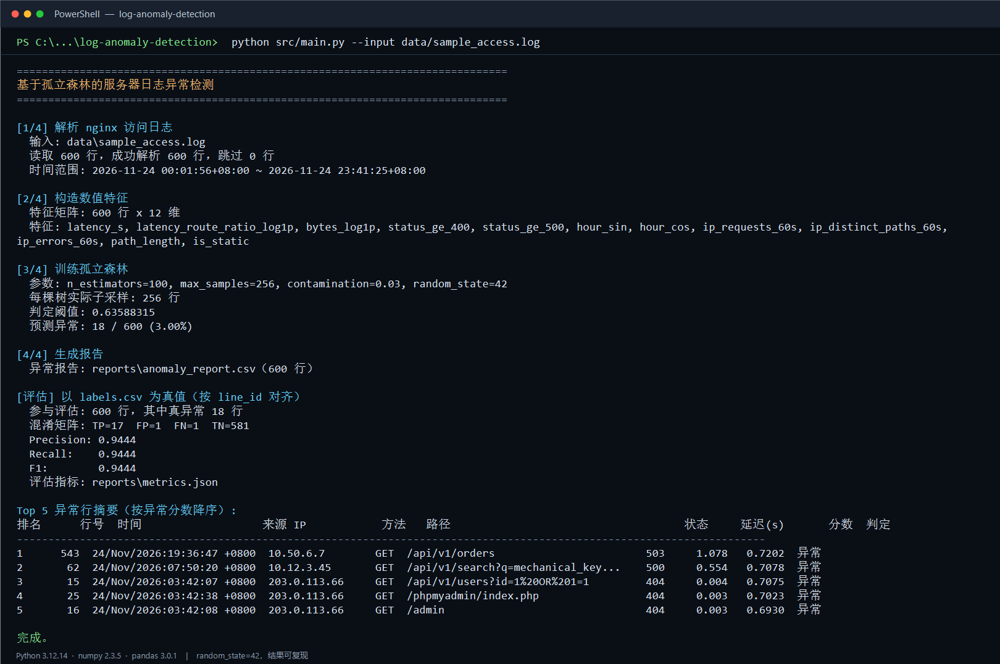

# 基于孤立森林的服务器日志异常检测

对 nginx 访问日志做正则解析与特征工程，使用纯 NumPy 实现的孤立森林进行无监督异常检测，输出异常清单、评估指标和可复现实验命令。

## 背景

服务器每天产生大量访问日志，人工巡检成本高。多数请求有稳定模式：业务接口以 200 为主，静态资源响应快，白天流量高而凌晨低。异常可能表现为极端慢请求、5xx 或单个 IP 在短时间内批量扫描 404。真实环境通常缺少逐条标注，因此先做无监督异常打分，把最可疑的少量请求排到前面，再由运维复核。

## 方法

- **数据**：`data/sample_access.log` 是脚本生成的 600 行合成 nginx 访问日志，字段包括 `ip, time, method, path, status, bytes, referer, ua, latency`。真值表 `data/labels.csv` 共 600 行，其中 18 行（3.0%）标为异常：3 条 3~15 秒的极端慢请求、3 条 5xx、12 条同一 IP 在同一分钟内对 12 个不同路径发起的 404 扫描。生成过程固定随机种子 `20261124`；日志仅包含 `10.0.0.0/8`、`192.0.2.0/24`、`198.51.100.0/24`、`203.0.113.0/24` 中的地址，以及 `example.com` / `example.internal` 假域名。
- **处理**：用正则解析 nginx combined 格式的扩展字段并保留物理行号；`bytes`、`latency` 缺失或非法时以中位数填补，确保进入模型的矩阵没有 NaN / inf。共构造 12 维特征：原始延迟、按路由模板中位数归一化的相对延迟（log1p）、`bytes` 的 log1p、状态码 >=400 与 >=500 标志、小时的 sin/cos 周期编码、同一 IP 在前后 60 秒窗口内的请求数 / 不同路径数 / 错误数、路径长度、是否静态资源。
- **模型**：纯 NumPy 的孤立森林（Liu, Ting & Zhou, 2008），参数为 `n_estimators=100`、`max_samples=256`、`contamination=0.03`、`random_state=42`。每棵树随机抽取 256 条样本，在当前节点随机选择特征和切分点；路径长度使用 `c(n) = 2H(n-1) - 2(n-1)/n`，异常分数为 `s = 2 ** (-E[h] / c(max_samples))`，阈值取分数的 97% 经验分位数。选择它是因为它是无监督方法、无需标注、对高维稀疏特征相对不敏感、训练复杂度约为 `O(n log n)`，适合作为异常筛查的第一层。

## 结果

在 600 行合成日志上的**实际运行结果**（以 `data/labels.csv` 为真值）：

| 指标 | 数值 |
|---|---:|
| TP / FP / FN / TN | 17 / 1 / 1 / 581 |
| Precision | 0.9444 |
| Recall | 0.9444 |
| F1 | 0.9444 |
| 预测异常数 / 真实异常数 | 18 / 18 |

模型识别出了全部 12 条 404 扫描、3 条 5xx 和 2/3 条极端慢请求；漏掉 1 条延迟 10.636 秒的 `/api/v1/orders` 请求，并把 1 条正常的 401 登录请求误报为异常。该漏报说明单个慢请求可能被其他维度的随机切分稀释，实际使用时仍需要人工复核分数靠前的请求。

运行截图见 [screenshots/run-output.png](screenshots/run-output.png)：



## 怎么跑

```bash
pip install -r requirements.txt

# 可选：重新生成固定种子的样例数据
python src/gen_fake_logs.py

python src/main.py --input data/sample_access.log
```

运行完成后生成：

- `reports/anomaly_report.csv`：600 行，包含原始关键字段、`anomaly_score`、`is_anomaly`（0/1），按异常分数降序排列。
- `reports/metrics.json`：标签存在时写入 precision / recall / F1 和混淆矩阵；没有标签则跳过评估。
- 可用 `--labels`、`--contamination`、`--out` 调整参数，例如 `python src/main.py --contamination 0.05 --out reports`。

## 技术栈

- Python 3.12
- NumPy 2.3.5：孤立森林、采样、特征计算
- pandas 3.0.1：日志解析后的表格处理与聚合
- 标准库：`argparse`、`re`、`csv`、`json`、`pathlib`

未使用 scikit-learn；孤立森林是本仓库内的纯 NumPy 实现。

## 局限

- 样例是高度可控的合成数据，指标不代表生产环境；真实异常分布更复杂，标注也通常不完整。
- `contamination=0.03` 是人为先验，异常比例变化时需要重新设定；分位数阈值不保证阈值以上一定是异常。
- 特征仍是手工设计的，模型对“相对延迟”等强特征依赖较大；单个慢请求可能被其他维度的随机切分稀释。
- 为同时满足 600 行总量和 1%~3% 异常比例，404 扫描 burst 被压缩为 12 条；生产中的扫描往往是几十到上千条，建议与网关频控和规则告警结合使用。
